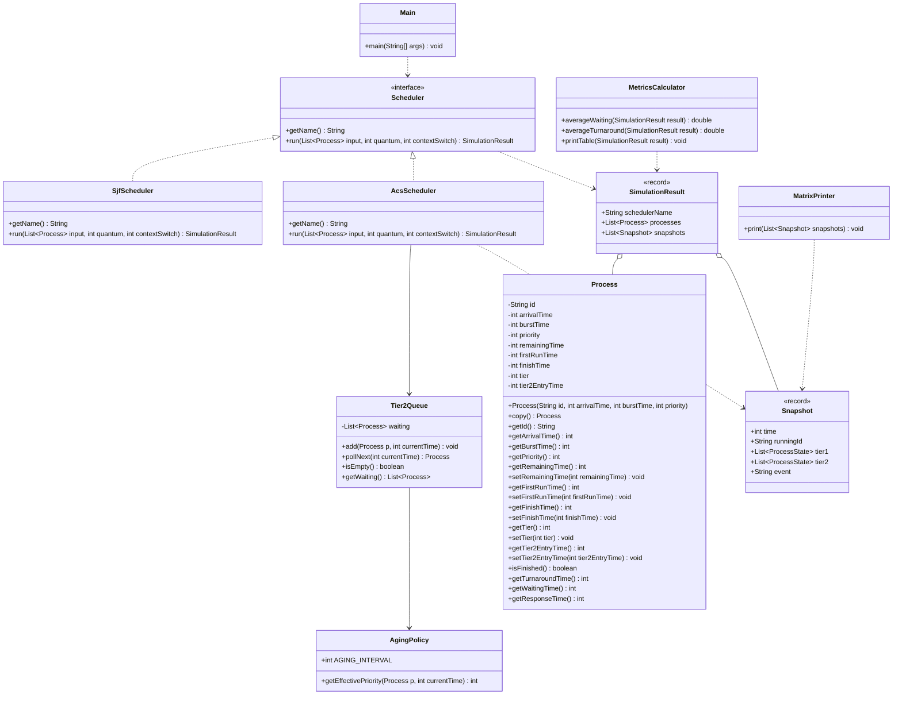

# Class Diagram

The diagram below shows the shared base and Member 1's Preemptive SJF
implementation. The ACS scheduler and the utility classes are still stubs.
Paste it into [mermaid.live](https://mermaid.live) or use the Mermaid extension
in VS Code / IntelliJ to view it.

## What each class does

### `Process`
One process in the simulation. The four input values (`id`, `arrivalTime`,
`burstTime`, `priority`) never change. The other fields are simulation state:
`remainingTime`, `firstRunTime`, `finishTime`, `tier` and `tier2EntryTime`.
`copy()` returns a clean copy with the same input data, so schedulers never
modify the caller's list. The three metric methods implement the formulas
`Turnaround = Finish - Arrival`, `Waiting = Turnaround - Burst` and
`Response = FirstRun - Arrival`.

> The class name hides `java.lang.Process` inside the `scheduler` package. This
> is intentional; use the full name `java.lang.Process` if the JDK class is ever
> needed.

### `Scheduler`
The common interface for both schedulers. `getName()` returns a display name and
`run(...)` returns a `SimulationResult`. Its Javadoc states the four shared
rules: do not modify the input, set `firstRunTime`/`finishTime`, count context
switches, and ignore `quantum` in SJF.

### `SjfScheduler`
Member 1's implemented preemptive Shortest Job First scheduler. It works on
`Process.copy()` objects, runs the shortest remaining time, charges context
switches on a change of process (including after a finish), and returns the
copies in the original input order with an empty snapshot list. It ignores
`quantum`.

### `AcsScheduler`
Member 2's Adaptive Container Scheduler implementation. Currently a TODO stub
that throws `UnsupportedOperationException`. It owns Tier 1 Round Robin, the
demotion to Tier 2, the non-preemptive Tier 2 execution, context-switch
handling, and filling `Snapshot` objects. It uses `Tier2Queue` for Tier 2.

### `Tier2Queue`
The non-preemptive priority queue for Tier 2. **Currently a TODO stub (Member
2).** The planned behaviour: `add(process, time)` sets `tier = 2` and records
`tier2EntryTime`. `pollNext(time)` removes and returns the process with the
lowest effective priority, breaking ties by earlier Tier 2 entry time and then
by id. `getWaiting()` returns a copy for snapshots.

### `AgingPolicy`
The Tier 3 aging rule. **Currently a TODO stub (Member 3).** The planned
behaviour: `AGING_INTERVAL = 4` and `getEffectivePriority(process, currentTime)`
returns `priority - floor(waitTime / 4)`. If the process has never entered Tier
2, it returns the base priority. The result is not clamped.

### `SimulationResult`
A record holding one scheduler run: the scheduler name, the finished process
copies, and the recorded snapshots. Its compact constructor makes defensive
copies of both lists.

### `Snapshot`
A record holding one time step: the time, the running process id (or `null` if
the CPU is idle), the Tier 1 and Tier 2 contents, and a short event description.
It stores plain values, not live `Process` objects.

`Snapshot.ProcessState` is a **nested record**
(`id`, `remaining`, `effectivePriority`). It is not drawn as a separate box
because it only exists inside a `Snapshot`; keeping it nested also keeps the
relationship list below exactly as the team agreed.

### `MatrixPrinter`
**Currently a TODO stub (Member 3).** The planned behaviour: prints the tier
matrix from a list of snapshots: `Time`, `Process`, `Tier 1` and `Tier 2`.
Empty queues show `[Empty]`.

### `MetricsCalculator`
**Currently a TODO stub (Member 3).** The planned behaviour: calculates average
waiting and average turnaround time, and prints the per-process table with the
columns `Process`, `Arrival`, `Finish`, `Turnaround`, `Waiting`, `Response`,
`Burst`.

### `Main`
**Currently a TODO stub (Member 4).** The planned behaviour: hold the two test
cases, run both schedulers on both cases, and call `MatrixPrinter` and
`MetricsCalculator`. The current `main` only contains a TODO comment and does
not call anything that throws.

## Relationships

- `Scheduler <|.. SjfScheduler` / `Scheduler <|.. AcsScheduler`: both
  schedulers implement the interface.
- `AcsScheduler --> Tier2Queue`: ACS owns and uses the Tier 2 queue.
- `Tier2Queue --> AgingPolicy`: the queue asks the aging policy for effective
  priorities.
- `AcsScheduler ..> Snapshot`: ACS creates snapshots.
- `Scheduler ..> SimulationResult`: `run(...)` returns a result.
- `SimulationResult o-- Process`: a result aggregates the simulated processes.
- `SimulationResult o-- Snapshot`: a result aggregates the snapshots.
- `MatrixPrinter ..> Snapshot`: the printer reads snapshots.
- `MetricsCalculator ..> SimulationResult`: the calculator reads a result.
- `Main ..> Scheduler`: `Main` runs schedulers through the interface.
